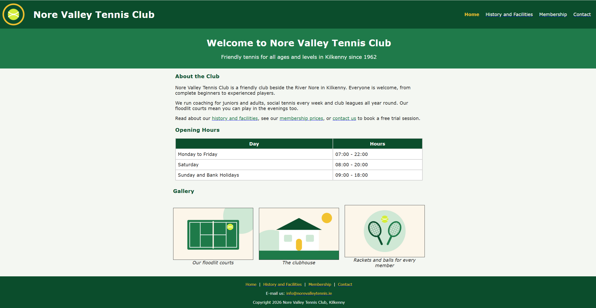

# Nore Valley Tennis Club

A small website for a local tennis club in Kilkenny, made as a college web design project.
The website promotes the club to existing and new members.



## Pages

| Page | What is on it |
| --- | --- |
| `index.html` | Home: about the club and opening hours |
| `history.html` | History of the club and club facilities |
| `membership.html` | Membership details and prices |
| `contact.html` | Contact details and club officials |

## Project requirements

- A simple logo on each page
- Paragraphs of text and 3 pictures on each page
- Four separate pages
- Internal links between the pages
- External links to Google Maps and Tennis Ireland
- An e-mail link (`mailto:`) on each page

## Folder structure

```
site/
├── index.html
├── history.html
├── membership.html
├── contact.html
├── images/         logo and pictures used on the pages
└── pictures/       screenshot for this README
```

## Built with

- HTML only (tables for layout, `bgcolor` and `<font>` for colours)

## How to open

Download the project and open `index.html` in any web browser.

## Note

Nore Valley Tennis Club is a made-up club. The names, phone number and e-mail addresses are not real.
The logo and all pictures were drawn for this project.
